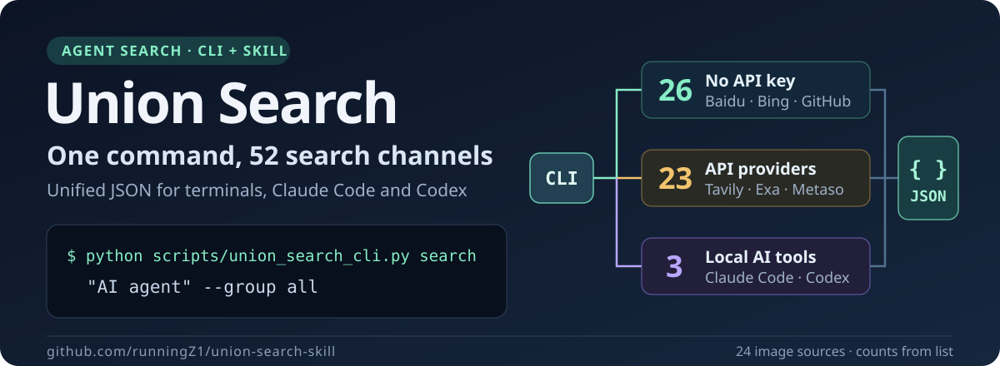
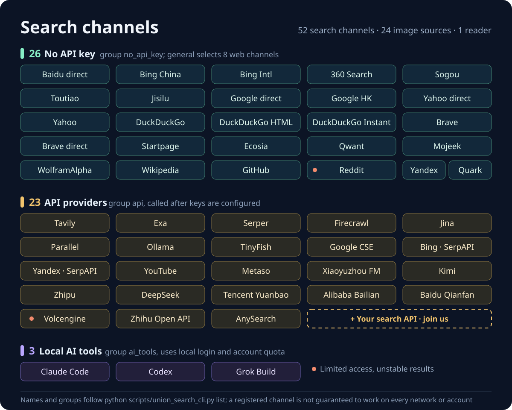
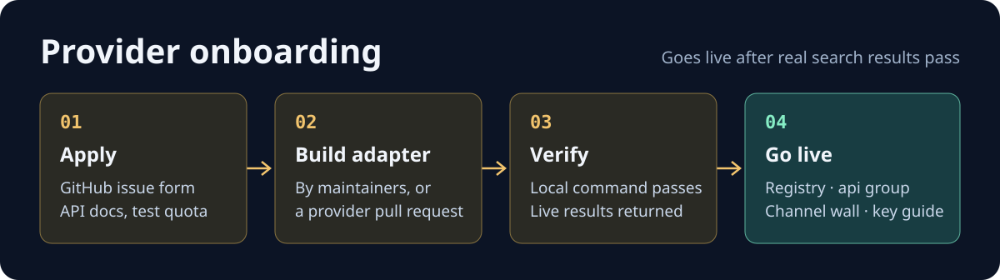

<a id="top"></a>

<p align="right"><a href="README.md">简体中文</a> · <b>English</b></p>

<p align="center">
  
</p>

<p align="center">
  <a href="LICENSE"></a>
  
  
  
</p>

<p align="center">
  <a href="#quickstart">Quick start</a> ·
  <a href="#channels">Channels</a> ·
  <a href="#agents">Agent integration</a> ·
  <a href="#providers"><b>For search providers</b></a> ·
  <a href="SKILL.md">Skill guide (Chinese)</a>
</p>

**Union Search** is a multi-source search tool for Claude Code, Codex and the command line. Send one question to any combination of search channels, cap results per channel, and get JSON, Markdown or plain text. It also extracts readable web page content and downloads images and media.

> [!NOTE]
> **This is a major update.** It has been several months since the last consolidated release. This update changes search channels and groups, the unified CLI and output format, agent integration, API key setup, the project layout, and the documentation and license. If you are upgrading, reread [Quick start](#quickstart) and [Channels](#channels), and check that your commands, configuration and automation scripts still apply.
>
> The scope is large, so some gaps or compatibility issues may remain. Provider APIs, login rules, quotas and pages also change over time; a registered channel is not guaranteed to work on every account, network or environment. Please report problems in [GitHub Issues](https://github.com/runningZ1/union-search-skill/issues) with the channel, command, expected and actual behavior, environment and a redacted error, as described in [Reporting issues](#contributing).

## What it does

| Task | Entry point | Result |
| --- | --- | --- |
| Query several search engines at once | `search --platforms …` or `search --group …` | Clean web fields, URL-based source merging, channel status and timing |
| Query one platform | `platform <name>` | Structured results from one channel |
| Read a web page | `defuddle <url>` | Main content, optionally saved as Markdown |
| Download images and media | `image`, `download` | Local files; media downloads use yt-dlp |
| Let agents discover capabilities and handle errors | `schema`, `errors`, `doctor` | Machine-readable capabilities, error codes and environment checks |

<a id="quickstart"></a>

## Quick start

### 1. Get the code and install dependencies

```bash
git clone https://github.com/runningZ1/union-search-skill.git
cd union-search-skill
python -m pip install -r requirements.txt
```

If this directory is already installed as a skill, run the commands below from the skill directory. Agents should read [SKILL.md](SKILL.md) first.

### 2. Check the environment

```bash
python union_search_cli.py doctor --platforms github --pretty
```

`doctor` checks that dependencies and credentials are present; it does not test whether remote services respond. Image, download and reader features have separate dependencies, listed in [Configuration](#configuration).

To configure APIs, create `.env` from the template. This command copies the template only when `.env` does not exist yet:

```bash
python -c "from pathlib import Path; p = Path('.env'); p.exists() or p.write_bytes(Path('.env.example').read_bytes())"
```

Fill in credentials only for the channels you need. GitHub repository search works without a token; a token usually raises the rate limit.

### 3. Run your first search

```bash
python union_search_cli.py platform github "readme topic:documentation" --limit 3 --pretty --fail-on-platform-error
```

Output is JSON by default; `--pretty` only adds indentation. Check the top-level `ok` first, then read `data.items`. The unified CLI's search, image and media download commands do not accept `--json`; `defuddle --json` requests extraction metadata, while `--format` still controls the outer output format.

<a id="examples"></a>

## Examples

### Search selected channels together

```bash
python union_search_cli.py search "AI agent" --platforms github wikipedia --limit 3 --deduplicate --pretty --fail-on-platform-error
```

By default there is no local result cap: every result fetched in this run is returned, and `--limit 0` means the same. A positive `--limit N` caps results per platform. `--deduplicate` removes duplicates across channels, `--max-workers` sets concurrency and `--timeout` sets the timeout in seconds. A failed channel is never silently replaced by another provider; the caller chooses other channels.

"No cap" does not mean unlimited paging: per-request API limits, page capacity, model output windows and timeouts still apply. API batch parameters are kept, and returned rows are not trimmed to the first 5 / 10 / 20 by default. The image command keeps all results fetched in the current run; native image search fetches one finite page and does not traverse all pages. An explicit `--preset` enables its result cap.

### Search by group

```bash
python union_search_cli.py list --type groups --pretty
python union_search_cli.py search "Python" --group general --preset small --pretty
python union_search_cli.py search "AI agent" --group api --preset small --pretty
```

`general` needs no mandatory API key and is the default when no channels or group are given. `api` calls the whole API group and needs each provider's credentials; to use only a few, pass `--platforms tavily metaso`. `small`, `medium`, `large` and `extra` mean 3, 5, 10 and 20 results per channel.

### Web channels and parameters

The default 8 web channels are `baidu_direct`, `so360_direct`, `sogou_direct`, `duckduckgo`, `brave`, `yahoo`, `yandex_direct` and `quark_direct`, in that order. Web channels are independently implemented in this project with no external project runtime dependency. 360, Sogou, DuckDuckGo, Brave and Yahoo use `curl_cffi>=0.16,<0.17`; Yandex and Quark use anonymous access.

```bash
python union_search_cli.py platform duckduckgo "Python packaging" --param page=2 --limit 3 --pretty
```

Repeat `platform --param key=value` to pass web options: `page`, `timelimit`, `proxy`, `region`, `country` and `safesearch`. Support varies by channel; unsupported parameters fail explicitly. DuckDuckGo web supports only `page`; it rejects `timelimit` and `region` values other than `wt-wt`. The compatibility entries `duckduckgo_html`, `brave_direct` and `yahoo_direct` share their service implementation. Each combined request deduplicates sources and executes only the first entry for a service; `--deduplicate` separately controls result deduplication.

### Save readable results

```bash
python union_search_cli.py search "Python packaging" --platforms github --limit 5 --format markdown -o out/search.md
```

JSON, Markdown and text output all keep the complete data; Markdown shows each channel's full fields in JSON code blocks. `-o` writes to a file and creates the target directory.

### Extract web page content

After installing Node.js and the Node dependencies listed below:

```bash
python union_search_cli.py defuddle "https://example.com" --pretty
python union_search_cli.py defuddle "https://example.com" --format markdown -o out/article.md
```

This uses the local Defuddle engine. Jina, Firecrawl and other reader engines are in the [url_to_markdown module](scripts/url_to_markdown/).

### Search and download images

```bash
python union_search_cli.py image "mountain landscape" --search-only --limit 5 --pretty
python union_search_cli.py image "mountain landscape" --platforms bing --limit 5 --output-dir image_downloads --pretty
```

The default image platforms are `baidu bing wikicommons`, independently implemented in this project. `--search-only` returns results and metadata from native platforms without downloading; unsupported platforms return an explicit error. The default mode searches and downloads. Use `--platforms` to select retained SDK platforms explicitly. Failed platforms do not trigger an automatic switch to another source.

Each image keeps dictionary metadata for its title, image URL, source page, thumbnail, dimensions, author, license and image version; missing fields are `null`. `image_variant` identifies the source's original or largest available version; see the [image module guide](scripts/union_image_search/README.md) for fields. Downloads are checked with Pillow `Image.verify()` and record `sha256`, `bytes`, file location and download status. Individual download failures remain in the results; partial failures return `ok: false` while retaining `data`.

### Download media from search results

```bash
python union_search_cli.py search "Python tutorial" --platforms youtube --limit 3 -o out/videos.json --pretty --fail-on-platform-error
python union_search_cli.py download --from-file out/videos.json --select 1 --output-dir downloads --pretty
```

The first step needs `YOUTUBE_API_KEY`. `download_candidates` in the search result lists candidate indexes; inspect them, then pick with `--select`. Media downloads use yt-dlp; merging audio and video or extracting audio also needs FFmpeg. What can be downloaded depends on the site and login state; see the [CLI documentation](scripts/cli/README.md).

<a id="channels"></a>

## Channels

<p align="center">
  
</p>

The registry currently has **53 capabilities, including 52 search channels**: **26 need no mandatory API key**, **23 need an API key**, and **3 use a local AI coding tool login**. There is also 1 reader tool (Defuddle) and 24 image sources: 12 native platforms and 12 SDK platforms. Different access modes of one service count as separate channels. The command output is authoritative:

```bash
python union_search_cli.py list --pretty
python union_search_cli.py schema --pretty
```

| Group | Contents | Notes |
| --- | --- | --- |
| `general` / `search` / `preferred` | Baidu, 360, Sogou, DuckDuckGo, Brave, Yahoo, Yandex and Quark: 8 web channels | `general` is the default; no mandatory API key |
| `api` | Tavily, Exa, Serper, Firecrawl, Metaso, Kimi, Zhipu, DeepSeek, AnySearch and more, 23 channels | Needs each provider's credentials; AnySearch requires `ANYSEARCH_API_KEY`, and Xiaoyuzhou FM uses `METASO_API_KEY` |
| `ai_tools` | Claude Code, Codex, Grok Build | Uses local login and account quota; not in the default group |
| `no_api_key` | All 26 search channels without a mandatory API key, including GitHub and Wikipedia | Select the complete group or individual channels as needed |
| `dev` | GitHub, Reddit | Topic subset, no mandatory API key |
| `social` | YouTube, Zhihu Open API, Xiaoyuzhou FM | Topic subset; all three need API keys |
| `tools` | Defuddle | Web page reader; use the dedicated `defuddle` command |
| `all` | All 52 search channels | Includes API and local-account channels, excludes Defuddle |

Native image platforms: `baidu`, `bing`, `sogou`, `quark`, `pixabay`, `flickr`, `pinterest`, `500px`, `wikicommons`, `naver`, `artstation`, `findthatmeme`.

Retained SDK image platforms: `google`, `i360`, `yandex`, `yahoo`, `unsplash`, `gelbooru`, `safebooru`, `danbooru`, `pexels`, `huaban`, `foodiesfeed`, `volcengine`.

See the [search output field index](references/output_fields.md) for upstream formats, retained fields, CLI mappings, missing-value rules, common parameters, and per-request result limits. Each service directory contains its own `output-analysis.md` document in Chinese, with a capacity table distinguishing official limits, module defaults, pagination, and local truncation, with verification sources. Channels with nonempty successful responses also keep real JSON samples and provenance files in their local `examples/` directory.

### Known limits

- The TikHub integration has been removed, including Xiaohongshu, Douyin, Bilibili, Twitter, Weibo and the old Zhihu search; the separate `zhihu_official` channel remains.
- Reddit and Volcengine are marked `degraded` because of access restrictions and past parsing instability.
- `stable` in the registry is code metadata only and says nothing about live health. Zero results can also come from CAPTCHAs or broken selectors.
- "No API key" still means remote calls: GitHub, Wikipedia and others are called anonymously and may hit CAPTCHAs, rate limits or empty results.
- Standalone modules outside the unified CLI registry have their own guides: [RSS](scripts/channels/rss_search/README.md) and [WeChat](scripts/channels/wechat/README.md).
- `bing` and `yandex` use SerpAPI; `bing_cn_direct`, `bing_int_direct`, and `yandex_direct` use web access without API keys. Yahoo's `yahoo_direct` is a compatibility name for `yahoo`, sharing its implementation; combined searches deduplicate these names by source.

<a id="configuration"></a>

## Configuration

| Feature | Dependency or setting | Notes |
| --- | --- | --- |
| Python search entry | [requirements.txt](requirements.txt) | `python -m pip install -r requirements.txt` |
| GitHub search | Optional `GITHUB_TOKEN` | Code search and similar features follow GitHub's auth rules |
| Google API search | `GOOGLE_API_KEY`, `GOOGLE_SEARCH_ENGINE_ID` | Used by `google`, separate from `google_direct` |
| YouTube / Zhihu Open API / Xiaoyuzhou FM | `YOUTUBE_API_KEY` / `ZHIHU_ACCESS_SECRET` / `METASO_API_KEY` | Each uses its own service |
| AI search providers | The provider's API key | See the [credential guide](references/api_credentials.md) and module docs |
| Local AI tool search | Python 3.10+ and a logged-in Claude Code / Codex / Grok Build | See the [AI tools guide](scripts/channels/ai_tools/README.md) |
| Image search and downloads | `Pillow>=12`, `chompjs>=1.2`; SDK platforms use `pyimagedl`; some sources need credentials | Native platforms are independently implemented; downloaded image content is verified |
| Media downloads | yt-dlp, optional FFmpeg and cookies | Format merging and audio extraction need FFmpeg |
| Defuddle / WeChat JS module | Node.js, npm and module dependencies | Install with the commands below |

```bash
npm install
npm --prefix scripts/url_to_markdown/engines/defuddle-node ci
python union_search_cli.py doctor --pretty
```

Commands read `.env` from the current working directory, so run them from the repository root or pass `--env-file`. All variables are listed in [.env.example](.env.example); see also the [platform notes](references/platform_notes.md) and [rate limits](references/rate_limits.md).

<a id="api-key-setup"></a>

### Let an agent set up API keys

For API key setup, we recommend the **Ego Lite browser** with an agent that can read and write local files. The agent opens the official consoles, reads or creates keys, writes them to the local `.env` and runs a real search to verify each one. Ego Lite supports **macOS and Windows**; once the browser is ready and you have granted permission, there is no need to find, copy and paste keys platform by platform.

Before starting, use Ego Lite's first-run setup to import login state, cookies, extensions and bookmarks from your everyday Google Chrome profile, then confirm the signed-in identities. API keys live in provider consoles, local configuration or a password manager; Chrome has no generic "API key" profile item, and the official migration notes do not promise to import saved passwords or API keys. Some sites may still ask you to sign in again, solve a CAPTCHA or pass two-factor authentication.

If Ego Lite is unavailable, use the **Codex or ChatGPT desktop app** in an environment that provides Computer Use. Confirm first that it can operate web pages, write local files and access the needed logins. Screenshot-based Computer Use usually takes more visual input and more steps and may consume more tokens, so Ego Lite comes first. CAPTCHAs, identity verification and payment decisions remain with you.

<details>
<summary>Prompt to send to the agent (replace the project path and channels)</summary>

```text
Please configure API keys for my Union Search Skill.
Project path: <absolute local path of union-search-skill>
Channels needed: tavily, exa, metaso (replace as needed; not every platform is required).

First read references/agent_api_key_setup.md, SKILL.md and .env.example in the project,
and check the credentials, official consoles and local storage location for these channels.
Prefer Ego Lite (macOS and Windows): read the ego-browser skill and run it.
Reuse the login state migrated from Chrome and confirm the target accounts first.
I authorize reading existing keys; if none can be read, create keys with the minimum
permissions this project needs, write them directly to .env in the project root,
and run one small real search per target channel to verify.
I accept the related quota usage; keep all other settings and continue within this authorization.
If Ego Lite is unavailable, switch to Codex or ChatGPT desktop Computer Use,
confirm it can operate web pages and write local files, and mention the extra token cost.
Finish key retrieval, local storage and API verification automatically; when a site needs
my own sign-in, identity verification or payment confirmation, let me handle it on that page,
then continue. Never show keys in chat, and finally report configuration and verification status.
```

</details>

Batch setup, authorization replies, resume prompts and where to find keys on each platform are covered in the [agent API key guide](references/agent_api_key_setup.md) (Chinese). Credentials can live in the local documentation folder `local_dev_doc/api-credentials/` and be loaded with `--env-file`, or be written to the root `.env` if you prefer. After saving a key, still check dependencies, permissions, quota and API responses before treating the channel as usable.

<a id="agents"></a>

## Agent integration

Agents read [SKILL.md](SKILL.md) first, then discover current capabilities through the CLI:

```bash
python union_search_cli.py schema --pretty
python union_search_cli.py errors --pretty
python union_search_cli.py doctor --platforms github --pretty
```

The unified entry point writes JSON to stdout and diagnostics to stderr; `--quiet` turns diagnostics off. Programs should read `schema_version`, `ok`, `type` and `meta`, then read results from `data`; on failure, also inspect `error` and channel statuses. The success envelope looks like this, with compatibility fields omitted:

```json
{
  "schema_version": "1.0",
  "ok": true,
  "type": "result",
  "data": {},
  "meta": { "request_id": "req_example", "duration_ms": 42 }
}
```

On failure, inspect `error.code`, `error.retryable`, `error.outcome` and `error.next_actions`. Suggested commands that start with `union-search …` map to `python union_search_cli.py …`.

| Exit code | Meaning | Caller action |
| --- | --- | --- |
| `0` | Command finished | Still check `ok` and whether results are empty |
| `1` | Internal error | Keep the diagnostics |
| `2` | Invalid arguments or usage | Fix the arguments |
| `3` | Missing dependency or resource | Follow the error's suggestion |
| `4` | Timeout, rate limit or service unavailable | Decide on a bounded retry from the error |
| `130` | Interrupted | Stop further actions |

By default a search still exits with `0` when a platform fails; `ok` in the JSON is then `false`, so the exit code alone does not mean success. For strict scripts, add `--fail-on-platform-error` to `search` or `platform`, and a platform failure returns `4`. When some channels fail, the envelope retains `data`; callers can read successful results and inspect `error` and each channel's status.

<a id="providers"></a>

## For search providers

<p align="center">
  
</p>

If you offer a web search, AI search, vertical search or content extraction API, you are welcome to join Union Search. The `api` group already includes 23 API services such as Tavily, Exa, Serper, Firecrawl, Metaso, Kimi, Zhipu, DeepSeek, Tencent Yuanbao and Alibaba Bailian.

**Once integrated, your service appears in these places:**

| Placement | What users see |
| --- | --- |
| README [channel wall](#channels) | Your service name on the wall, plus group notes |
| Unified CLI registry | `list` and `schema` show your channel, required variables and description, so agents can discover and select it directly |
| `api` and `all` groups | Called together with other providers on `--group api`, or alone with `--platforms <name>` |
| Module docs `scripts/channels/<name>/README.md` | Official sign-up link, parameters, free quota and pricing |
| [Credential guide](references/api_credentials.md) and [agent API key guide](references/agent_api_key_setup.md) | Console link and steps, so users can let an agent create and store the key |

**What to prepare:**

- A public HTTP API with documentation; results include at least a title, a link and a snippet.
- A test key or free quota for verification.
- Clear authentication, pricing and rate-limit rules.
- Terms of service that allow calls from agents and command-line tools.

**How to apply:**

1. Fill in the [provider listing request](https://github.com/runningZ1/union-search-skill/issues/new?template=provider_listing.yml) with your API docs, authentication, quota and response fields. Do not paste real keys into the issue.
2. Maintainers review it and reply with an integration plan in the issue; providers are also welcome to open a pull request following the checklist below.
3. Verification uses real searches: the local command passes and the live API returns valid results.
4. After the merge, your service is in the registry, the `api` group, the README channel wall and the credential guide.

Collaboration ideas such as dedicated quota for new users, joint announcements or cross-linked documentation can go in the "合作意向 / Collaboration" field of the form.

<details>
<summary>Code checklist for a new channel (for pull requests)</summary>

| File | Content |
| --- | --- |
| `scripts/channels/<name>/<name>_search.py` | A standalone search script with `--json` and `-m/--max-results` (no cap by default) that reads credentials from the project root `.env` |
| `scripts/union_search/union_search.py` | Register the channel in `PLATFORM_MODULES`, add `_search_<name>` and route it in `search_platform` |
| `scripts/union_search/platform_metadata.py` | Declare credentials in `REQUIRED_ENV` / `OPTIONAL_ENV`; the channel then joins `api` automatically |
| `.env.example` | New variables and their defaults |
| `scripts/channels/<name>/README.md`, `SKILL.md`, `references/api_credentials.md` | Module docs, skill guide and credential steps |
| `tests/` | Run real registry checks with `python -m unittest discover -s tests -p test_platform_groups.py` and verify changed channels through real entry points; see [AGENTS.md](AGENTS.md) |

</details>

<a id="troubleshooting"></a>

## Troubleshooting

| Symptom | First step |
| --- | --- |
| `unrecognized arguments: --json` | Remove `--json` from search, image and media download commands; JSON is the default and `--pretty` adds indentation. `defuddle --json` requests extraction metadata |
| Missing credentials or modules | Run `doctor --platforms <name>` and check the module docs |
| HTTP 403 / 429 | Check authentication, network egress and provider limits; use fewer channels and a lower `--max-workers` |
| Request finishes with no results | Try a more specific query; check for CAPTCHA pages or broken parsers |
| One failed channel makes the combined result `ok: false` | Read the retained `data` and channel statuses, then inspect the failed channel separately |
| Image command unavailable | Check `Pillow`, `chompjs` and, for selected SDK platforms, `pyimagedl` in the current Python environment |
| Defuddle does not run | Check Node.js, root npm dependencies and dependencies in `defuddle-node` |
| Media download gets 403 or format merging fails | Check yt-dlp and FFmpeg; pass `--cookies-file` explicitly if needed |

More details are in the [troubleshooting guide](references/troubleshooting.md) (Chinese).

<a id="structure"></a>

## Project layout

```text
union-search-skill/
├── union_search_cli.py          # Unified command entry point
├── SKILL.md                     # Agent guide and module index
├── AGENTS.md                    # Project responsibilities, development and validation rules
├── CLAUDE.md                    # Imports AGENTS.md
├── agents/                      # Skill interface and execution metadata
├── evals/                       # Skill structure and trigger boundary checks
├── .env.example                 # Environment variable template
├── scripts/
│   ├── cli/                     # Argument parsing, capability registry, error codes, output envelope
│   ├── union_search/            # Concurrent orchestration, groups and credential metadata
│   ├── channels/                # Search channels, one directory per service
│   │   ├── no_api/              #   Web requests, process-shared pacing and compatibility base class
│   │   ├── ai_tools/            #   Native search through Claude Code / Codex / Grok Build
│   │   ├── tavily_search/       #   API providers such as Tavily, Exa, Kimi
│   │   ├── baidu/               #   API and direct scripts of one service share a directory
│   │   └── …
│   ├── union_image_search/      # Image search orchestration and download
│   │   ├── providers/           #   Image source adapters
│   │   └── native_images.py     #   Unified fields, download and image verification
│   ├── url_to_markdown/         # Web page reader (Defuddle, Jina, Firecrawl)
│   └── downloader/              # yt-dlp media download
├── references/                  # Credential, channel, rate-limit and troubleshooting docs
├── tests/                       # Offline regression tests
├── assets/readme/               # README visuals
└── config/mcporter.json         # Exa MCP configuration
```

Runtime data stays out of version control: union search logs go to `search_logs/`, and raw channel responses go to `responses/` inside each channel directory. See the [CLI documentation](scripts/cli/README.md) for all options and the [union search module](scripts/union_search/README.md) for orchestration.

<a id="contributing"></a>

## Contributing and reporting issues

If a feature does not work, results look wrong, an upgrade breaks something or the docs are incorrect, please report it in [GitHub Issues](https://github.com/runningZ1/union-search-skill/issues). Search existing issues first; if there is no match, [open a new issue](https://github.com/runningZ1/union-search-skill/issues/new). Pull requests are welcome.

To help reproduce the problem, include where possible:

- The version or commit, operating system, and Python / Node.js versions.
- The channel, the full command and the minimal steps to reproduce.
- Expected and actual behavior, the exit code, and a redacted error message or screenshot.
- The `doctor` result for that channel, and whether the problem happens every time.

Never upload real API keys, tokens, cookies, a full `.env` file or screenshots containing credentials. If you are unsure of the cause, open an issue anyway and describe what you observed.

When adding or changing a channel, also update the channel script, groups, credential metadata, CLI help and module docs, and keep "the script exists", "the local command passes" and "the live service returns valid results" separate, so a single test is not presented as a long-term guarantee.

<a id="credits"></a>

## License and acknowledgements

The project currently uses the **MIT License**; see [LICENSE](LICENSE) for the full text. Original code and documentation in this repository are provided under that license; keep the copyright and license notices when you use, modify or distribute them. Third-party code, dependencies and bundled resources keep their own licenses, which the MIT License does not change.

| Purpose | Projects |
| --- | --- |
| HTTP requests, configuration and HTML parsing | [Requests](https://github.com/psf/requests), [python-dotenv](https://github.com/theskumar/python-dotenv), [lxml](https://github.com/lxml/lxml) |
| Logging and structured data validation | [Loguru](https://github.com/Delgan/loguru), [Pydantic](https://github.com/pydantic/pydantic) |
| Images, media download and processing | [Pillow](https://github.com/python-pillow/Pillow), [chompjs](https://github.com/Nykakin/chompjs), [pyimagedl / imagedl](https://github.com/CharlesPikachu/imagedl), [yt-dlp](https://github.com/yt-dlp/yt-dlp), [FFmpeg](https://ffmpeg.org/) |
| Search service SDKs | [tavily-python](https://github.com/tavily-ai/tavily-python), [firecrawl-py](https://pypi.org/project/firecrawl-py/) |
| Web extraction and Node.js tooling | [Defuddle](https://github.com/kepano/defuddle), [Cheerio](https://github.com/cheeriojs/cheerio), [Commander.js](https://github.com/tj/commander.js), [jsdom](https://github.com/jsdom/jsdom) |

Direct dependencies, optional components, sources of migrated code, external service boundaries and documentation references are listed in [THIRD_PARTY.md](THIRD_PARTY.md) (Chinese). The list reflects the current repository and is not a full license audit of transitive dependencies.

The MIT License does not grant any third-party API quota, account permission or rights to search result content. Each search service, local AI client and account remains subject to its own terms. The Computer Use setup guide is a procedure an agent runs after your authorization and requires your own tools, accounts and credentials.

[Back to top](#top)
