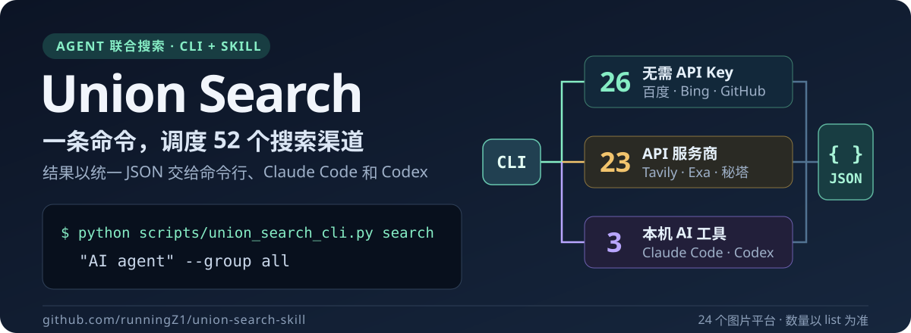
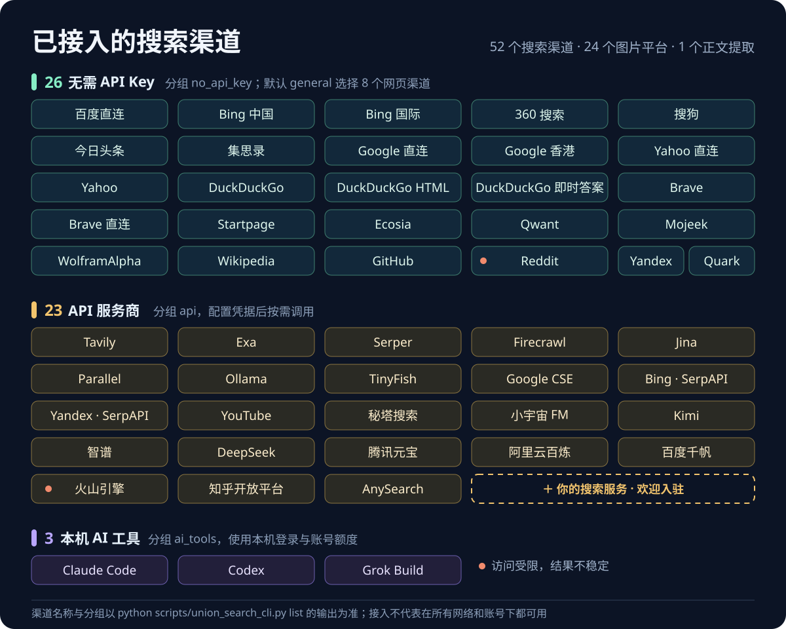
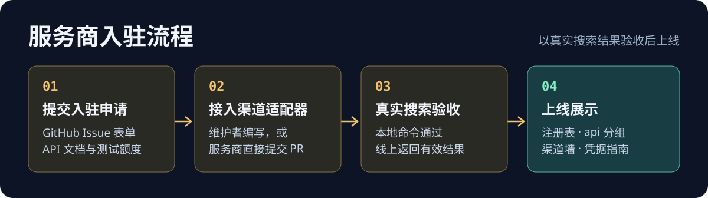

<a id="top"></a>

<p align="center">
  
</p>

<p align="center">
  <a href="LICENSE"></a>
  
  
  
</p>

<p align="center">
  <a href="#quickstart">快速开始</a> ·
  <a href="#channels">渠道一览</a> ·
  <a href="#agents">Agent 接入</a> ·
  <a href="#providers"><b>服务商入驻</b></a> ·
  <a href="SKILL.md">技能说明</a>
</p>

**Union Search** 是面向 Claude Code、Codex 和命令行用户的多平台搜索工具。同一个问题可以交给任意组合的搜索渠道，按渠道控制结果数，以 JSON、Markdown 或文本输出；还提供网页正文提取、图片下载和媒体下载入口。

> [!NOTE]
> **本次为重大更新。** 距离上一次集中更新已过去数月，本次改动涉及搜索渠道与分组、统一 CLI 和输出格式、Agent 接入、API Key 配置引导、项目目录结构，以及文档和开源协议说明。老用户升级后请重新阅读[快速开始](#quickstart)与[渠道一览](#channels)，检查现有命令、配置和自动化脚本是否仍然适用。
>
> 改动范围较大，可能仍有遗漏或兼容性问题；各平台的接口、登录要求、配额与页面也会变化，代码中已接入某个渠道，不代表它在所有账号、网络和运行环境下都能正常使用。遇到问题请提交 [GitHub Issues](https://github.com/runningZ1/union-search-skill/issues)，附上渠道、命令、预期与实际表现、运行环境及脱敏报错，具体见[问题反馈说明](#contributing)。

## 能做什么

| 你要完成的事 | 使用入口 | 结果 |
| --- | --- | --- |
| 一次查询多个搜索引擎 | `search --platforms …` 或 `search --group …` | 多渠道汇总，可选跨渠道去重 |
| 只查某一个平台 | `platform <name>` | 单渠道结构化结果 |
| 阅读网页正文 | `defuddle <url>` | 提取正文，可保存为 Markdown |
| 下载图片和媒体素材 | `image`、`download` | 本地文件；媒体下载基于 yt-dlp |
| 让 Agent 自己发现能力、处理错误 | `schema`、`errors`、`doctor` | 机器可读的能力清单、错误码与环境检查 |

<a id="quickstart"></a>

## 快速开始

### 1. 获取代码并安装依赖

```bash
git clone https://github.com/runningZ1/union-search-skill.git
cd union-search-skill
python -m pip install -r requirements.txt
```

如果已将此目录安装为 Skill，直接进入技能目录执行后续命令。Agent 使用前先阅读 [SKILL.md](SKILL.md)。

### 2. 检查环境

```bash
python union_search_cli.py doctor --platforms github --pretty
```

`doctor` 检查依赖与凭据是否存在，不会验证远程服务是否可用。图片、下载和正文提取的依赖各不相同，按[配置与依赖](#configuration)启用。

需要配置 API 时，从模板创建 `.env`。以下命令只在文件不存在时复制，保留已有配置：

```bash
python -c "from pathlib import Path; p = Path('.env'); p.exists() or p.write_bytes(Path('.env.example').read_bytes())"
```

按需要填入对应渠道的凭据，不必配置全部服务。GitHub 仓库搜索可先不填 Token；认证通常能提高请求额度。

### 3. 执行第一次搜索

```bash
python union_search_cli.py platform github "readme topic:documentation" --limit 3 --pretty --fail-on-platform-error
```

默认输出 JSON，`--pretty` 只调整缩进。先看顶层 `ok`，再读取成功结果中的 `data.items`。统一 CLI 不接受 `--json` 参数，无需额外传入。

<a id="examples"></a>

## 使用示例

### 指定渠道联合搜索

```bash
python union_search_cli.py search "AI agent" --platforms github wikipedia --limit 3 --deduplicate --pretty --fail-on-platform-error
```

默认不限制本地返回条数，返回本次取得的全部结果；`--limit 0` 同样表示不限，正整数 `--limit N` 是每个平台的结果上限。`--deduplicate` 启用跨渠道去重，`--max-workers` 控制并发，`--timeout` 设置超时秒数。渠道失败不会自动换成另一家服务，需要调用方选择其他渠道。

“不限”不等于无限翻页：API 单次请求量、站点页面容量、模型输出窗口和超时仍然生效。API 保留合法的请求批量参数，返回数据不会被默认截取为前 5 / 10 / 20 条。图片命令默认不做本地截断，底层图片 SDK 的批量请求范围为 10,000 张，仍受来源限制。显式 `--preset` 会启用相应条数上限。

### 按分组搜索

```bash
python union_search_cli.py list --type groups --pretty
python union_search_cli.py search "Python" --group general --preset small --pretty
python union_search_cli.py search "AI agent" --group api --preset small --pretty
```

`general` 无需配置必填 API Key，也是未指定渠道和分组时的默认范围。`api` 会调用整个 API 分组，需要先配置各服务的凭据；只想用其中几家时，改用 `--platforms tavily metaso`。`small`、`medium`、`large`、`extra` 分别对应每渠道 3、5、10、20 条。

### 保存便于阅读的结果

```bash
python union_search_cli.py search "Python packaging" --platforms github --limit 5 --format markdown -o out/search.md
```

JSON、Markdown 和文本输出都保留完整数据，Markdown 用 JSON 代码块呈现各渠道的完整字段。`-o` 保存到文件，目标目录会自动创建。

### 提取网页正文

安装 Node.js 与下文列出的 Node 依赖后：

```bash
python union_search_cli.py defuddle "https://example.com" --pretty
python union_search_cli.py defuddle "https://example.com" --format markdown -o out/article.md
```

这里调用本地 Defuddle 引擎。Jina、Firecrawl 等其他正文提取引擎见 [url_to_markdown 模块](scripts/url_to_markdown/)。

### 下载图片

```bash
python union_search_cli.py image "mountain landscape" --platforms bing --limit 5 --output-dir image_downloads --pretty
```

图片命令依赖 `pyimagedl`，默认保留元数据。可用平台名称通过 `list` 查看，部分图库还需要各自的 API Key。

### 从搜索结果下载媒体

```bash
python union_search_cli.py search "Python tutorial" --platforms youtube --limit 3 -o out/videos.json --pretty --fail-on-platform-error
python union_search_cli.py download --from-file out/videos.json --select 1 --output-dir downloads --pretty
```

第一步需要 `YOUTUBE_API_KEY`。搜索结果中的 `download_candidates` 提供候选索引，先查看候选再用 `--select` 选择。媒体下载依赖 yt-dlp；合并音视频或提取音频还需要 FFmpeg。下载能力取决于目标站点与登录状态，详见 [CLI 文档](scripts/cli/README.md)。

<a id="channels"></a>

## 渠道一览

<p align="center">
  
</p>

当前注册表共有 **50 个搜索渠道**：**25 个无需必填 API Key**、**22 个需要 API Key**、**3 个使用本机 AI coding 工具登录态**；另有 1 个正文提取工具（Defuddle）和 16 个图片平台。同一服务的不同访问方式按独立渠道计算。以运行结果为准：

```bash
python union_search_cli.py list --pretty
python union_search_cli.py schema --pretty
```

| 分组 | 内容 | 使用提示 |
| --- | --- | --- |
| `general` | 百度 / Bing 直连、DuckDuckGo、Wikipedia、GitHub、Reddit、匿名 AnySearch 等 25 个渠道 | 默认分组，无需必填 API Key |
| `api` | Tavily、Exa、Serper、Firecrawl、秘塔、Kimi、智谱、DeepSeek 等 22 个渠道 | 需配置对应凭据；小宇宙使用 `METASO_API_KEY` |
| `ai_tools` | Claude Code、Codex、Grok Build | 使用本机登录态与账号额度，不进入默认分组 |
| `search` / `no_api_key` | 与 `general` 相同 | 兼容旧命令 |
| `dev` | GitHub、Reddit | 主题子集，无需必填 API Key |
| `social` | YouTube、知乎开放平台、小宇宙 FM | 主题子集，三个渠道都需要 API Key |
| `preferred` | 代码中预设的 6 个无 API Key 渠道 | 预设分组，不代表当前网络下全部可用 |
| `tools` | Defuddle | 网页正文提取，使用专用 `defuddle` 命令 |
| `all` | 全部 50 个搜索渠道 | 包含 API 和本机账号渠道，不含 Defuddle |

图片渠道：`baidu`、`bing`、`google`、`i360`、`pixabay`、`yandex`、`sogou`、`yahoo`、`unsplash`、`gelbooru`、`safebooru`、`danbooru`、`pexels`、`huaban`、`foodiesfeed`、`volcengine`。

### 已知边界

- TikHub 接入已移除，包括小红书、抖音、Bilibili、Twitter、微博及旧知乎搜索；独立的 `zhihu_official` 保留。
- Reddit 和火山引擎标记为 `degraded`，分别有访问受限和历史解析不稳定的问题。
- 注册表中的 `stable` 只是代码元数据，不代表实时健康状态。零条结果也可能源于验证码或选择器失效。
- 无需 API Key 不等于不访问远程接口：GitHub、Wikipedia 和 AnySearch 等匿名调用，仍可能遇到验证码、限流或空结果。
- RSS、微信、Cloudflare、Querit 等独立模块没有注册为统一 CLI 渠道，可通过 [SKILL.md](SKILL.md) 的模块导航查找。

<a id="configuration"></a>

## 配置与依赖

| 功能 | 依赖或配置 | 说明 |
| --- | --- | --- |
| Python 搜索入口 | [requirements.txt](requirements.txt) | `python -m pip install -r requirements.txt` |
| GitHub 搜索 | `GITHUB_TOKEN` 可选 | 代码搜索等能力以 GitHub 的认证要求为准 |
| Google API 搜索 | `GOOGLE_API_KEY`、`GOOGLE_SEARCH_ENGINE_ID` | 对应 `google`，不同于 `google_direct` |
| YouTube / 知乎开放平台 / 小宇宙 | `YOUTUBE_API_KEY` / `ZHIHU_ACCESS_SECRET` / `METASO_API_KEY` | 各自使用独立服务 |
| AI 搜索服务 | 对应服务的 API Key | 见 [凭据指南](references/api_credentials.md) 和各模块文档 |
| 本机 AI 工具搜索 | Python 3.10+、本机已登录的 Claude Code / Codex / Grok Build | 见 [AI 工具搜索说明](scripts/channels/ai_tools/README.md) |
| 图片下载 | `pyimagedl`，部分平台另需凭据 | 安装 Python 依赖后由 `doctor` 检查 |
| 媒体下载 | yt-dlp、可选 FFmpeg 和 Cookie | 合并格式及音频提取需要 FFmpeg |
| Defuddle / 微信 JS 模块 | Node.js、npm 和模块依赖 | 按下面的命令安装 |

```bash
npm install
npm --prefix scripts/url_to_markdown/engines/defuddle-node install
python union_search_cli.py doctor --pretty
```

命令默认从当前工作目录读取 `.env`，请在仓库根目录执行，或通过 `--env-file` 指定路径。全部变量见 [.env.example](.env.example)，更多说明见[渠道说明](references/platform_notes.md)与[速率限制说明](references/rate_limits.md)。

<a id="api-key-setup"></a>

### 用 Agent 自动配置 API Key

涉及 API 密钥配置时，推荐使用 **Ego Lite 浏览器**配合具备本地文件读写能力的 Agent：自动访问官方控制台、获取或创建密钥、写入本地 `.env`，再执行真实搜索验证。Ego Lite 支持 **macOS 和 Windows**，浏览器准备完成并授权后，无需用户逐个平台查找、复制和粘贴密钥。

使用前，在 Ego Lite 首次启动的图形界面引导中，从日常 Google Chrome 个人资料导入登录状态、Cookie、扩展程序和书签，并检查登录身份。API Key 由各平台控制台、本地配置或密码管理器管理，Chrome 没有统一的“默认 API 密钥”资料项；官方迁移说明未明确承诺导入已保存密码或 API Key，需另行核对。部分网站仍可能要求重新登录、验证码或双重验证。

Ego Lite 无法使用时，可使用当前环境已提供 Computer Use 能力的 **Codex 或 ChatGPT 桌面端**，先确认该版本支持网页操作、本地文件写入及所需登录状态。基于截图的 Computer Use 通常需要更多视觉输入和操作轮次，可能消耗更多 token，因此优先使用 Ego Lite。验证码、实名认证和需要本人决定的付费操作仍由用户完成。

<details>
<summary>发给 Agent 的配置提示词（替换项目路径和所需渠道）</summary>

```text
请为我的 Union Search Skill 配置 API Key。
项目路径：<本机 union-search-skill 的绝对路径>
需要的渠道：tavily、exa、metaso（按需替换，不必配置全部平台）。

先阅读项目的 references/agent_api_key_setup.md、SKILL.md 和 .env.example，
核对这些渠道需要的凭据、官方入口和本地保存位置。
优先使用 Ego Lite（支持 macOS 和 Windows），阅读 ego-browser 技能并运行
ego-browser skill。复用从 Chrome 迁移的登录状态，先确认目标账号。
我授权读取现有密钥；没有可读取密钥时，可以创建本项目所需的最小权限密钥，
直接写入本项目根目录 .env，并对每个目标渠道执行一次小规模真实搜索验证。
我接受相应的请求额度消耗；保留其他配置，已有授权范围内连续完成。
Ego Lite 无法使用时，改用当前环境可用的 Codex 或 ChatGPT 桌面端 Computer Use，
先确认网页操作和本地文件写入能力，并说明可能增加的 token 消耗。
自动完成密钥获取、本地写入和接口验证；网站要求本人登录验证、实名认证或付费确认时，
让我在原页面处理，完成后继续。不在聊天中展示密钥，最后报告配置和验证状态。
```

</details>

完整的批量配置、授权回复、失败续接提示词，以及各平台的查找方向，见 [Agent 自动获取与配置 API Key 指南](references/agent_api_key_setup.md)。凭据可存放在项目本地文档文件夹 `local_dev_doc/api-credentials/`，通过 `--env-file` 加载；也可按用户选择写入根目录 `.env`。保存密钥后仍需检查依赖、权限、额度与接口响应，才能确认对应渠道可用。

<a id="agents"></a>

## Agent 接入

Agent 先阅读 [SKILL.md](SKILL.md)，再通过 CLI 发现当前能力：

```bash
python union_search_cli.py schema --pretty
python union_search_cli.py errors --pretty
python union_search_cli.py doctor --platforms github --pretty
```

统一入口把 JSON 写入 stdout，把诊断信息写入 stderr，`--quiet` 可关闭诊断日志。程序应读取 `schema_version`、`ok`、`type` 和 `meta`，成功时读取 `data`，失败时读取 `error`。以下只示意成功信封的结构，省略兼容字段：

```json
{
  "schema_version": "1.0",
  "ok": true,
  "type": "result",
  "data": {},
  "meta": { "request_id": "req_example", "duration_ms": 42 }
}
```

失败时检查 `error.code`、`error.retryable`、`error.outcome` 和 `error.next_actions`。错误建议中出现的 `union-search …` 可替换为 `python union_search_cli.py …`。

| 退出码 | 含义 | 调用方动作 |
| --- | --- | --- |
| `0` | 命令完成 | 继续检查 `ok` 与结果是否为空 |
| `1` | 内部错误 | 保留诊断信息 |
| `2` | 参数或用法错误 | 修正参数 |
| `3` | 缺少依赖或资源 | 按错误建议处理 |
| `4` | 超时、限流、服务暂不可用 | 根据错误信息决定是否有限重试 |
| `130` | 被中断 | 停止后续动作 |

搜索默认在平台失败时仍返回退出码 `0`，此时 JSON 的 `ok` 为 `false`，不能只靠退出码判断成功。需要脚本严格失败时，在 `search` 或 `platform` 命令上添加 `--fail-on-platform-error`，平台失败将返回 `4`。失败信封不保留成功的部分结果，调用方应缩小渠道范围后重新查询。

<a id="providers"></a>

## 服务商入驻

<p align="center">
  
</p>

如果你提供网页搜索、AI 联网搜索、垂直领域搜索或正文提取 API，欢迎接入 Union Search。目前已有 Tavily、Exa、Serper、Firecrawl、秘塔、Kimi、智谱、DeepSeek、腾讯元宝、阿里云百炼等 22 家 API 服务在 `api` 分组中。

**接入后，你的服务会出现在这些位置：**

| 位置 | 用户看到什么 |
| --- | --- |
| README [渠道一览](#channels) | 渠道墙中的服务名称，以及分组说明 |
| 统一 CLI 注册表 | `list`、`schema` 输出你的渠道、所需变量和说明，Agent 可以直接发现并选用 |
| `api` 与 `all` 分组 | 用户执行 `--group api` 时随其他服务一起被调用，也可用 `--platforms <name>` 单独调用 |
| 模块文档 `scripts/channels/<name>/README.md` | 官方注册入口、参数说明、免费额度与计费说明 |
| [凭据指南](references/api_credentials.md)与 [Agent 自动配置指南](references/agent_api_key_setup.md) | 控制台入口和获取方式，用户可以让 Agent 自动开通并写入 Key |

**入驻需要准备：**

- 公开的 HTTP API 与文档，返回结果至少包含标题、链接和摘要。
- 用于验收的测试 Key 或免费额度。
- 明确的认证方式、计费和限流规则。
- 服务条款允许通过 Agent 和命令行工具调用。

**申请方式：**

1. 填写[服务商入驻申请](https://github.com/runningZ1/union-search-skill/issues/new?template=provider_listing.yml)，说明 API 文档、认证方式、额度和返回字段。请勿在 Issue 中粘贴真实 Key。
2. 维护者评估后在 Issue 中回复接入计划；也欢迎服务商直接提交 Pull Request，按下面的清单实现。
3. 用真实搜索验收：本地命令通过，且线上接口返回有效结果。
4. 合并后，你的服务进入注册表、`api` 分组、README 渠道墙和凭据指南。

新用户专属额度、联合发布、文档互链等合作形式，可以在申请表的“合作意向”中说明。

<details>
<summary>新增渠道的代码清单（提交 PR 时对照）</summary>

| 文件 | 内容 |
| --- | --- |
| `scripts/channels/<name>/<name>_search.py` | 独立可运行的搜索脚本，支持 `--json` 与 `-m/--max-results`（默认不限），从项目根目录 `.env` 读取凭据 |
| `scripts/union_search/union_search.py` | 在 `PLATFORM_MODULES` 注册渠道，编写 `_search_<name>` 并加入 `search_platform` 分派 |
| `scripts/union_search/platform_metadata.py` | 在 `REQUIRED_ENV` / `OPTIONAL_ENV` 声明凭据，分组会据此自动归入 `api` |
| `.env.example` | 新增变量及默认值说明 |
| `scripts/channels/<name>/README.md`、`SKILL.md`、`references/api_credentials.md` | 模块文档、技能导航和凭据获取方式 |
| `tests/` | `python -m pytest tests` 全部通过 |

</details>

<a id="troubleshooting"></a>

## 故障排查

| 现象 | 先做什么 |
| --- | --- |
| `unrecognized arguments: --json` | 删除 `--json`；统一 CLI 默认输出 JSON，缩进用 `--pretty` |
| 缺少凭据或模块 | 运行 `doctor --platforms <name>`，对照对应模块的说明 |
| HTTP 403 / 429 | 检查认证、网络出口与服务限流；缩小渠道范围，降低 `--max-workers` |
| 请求完成但没有结果 | 换一个明确关键词；检查是否为验证码页面或解析器失效 |
| 一个渠道失败导致联合结果 `ok: false` | 单独查询该渠道；需要其他结果时，只选择其余渠道重跑 |
| 图片命令不可用 | 检查 `pyimagedl` 是否安装在当前 Python 环境中 |
| Defuddle 无法运行 | 检查 Node.js、根目录 npm 依赖与 `defuddle-node` 子目录依赖 |
| 媒体下载遇到 403 或格式合并失败 | 检查 yt-dlp、FFmpeg，必要时显式传入 `--cookies-file` |

详细说明见[故障排查文档](references/troubleshooting.md)。

<a id="structure"></a>

## 项目结构

```text
union-search-skill/
├── union_search_cli.py          # 统一命令入口
├── SKILL.md                     # Agent 使用指引与模块导航
├── .env.example                 # 环境变量模板
├── scripts/
│   ├── cli/                     # 参数解析、能力注册、错误码与输出信封
│   ├── union_search/            # 多渠道并发编排、分组与凭据元数据
│   ├── channels/                # 搜索渠道，每个服务一个目录
│   │   ├── no_api/              #   无 API Key 网页引擎的共享基类
│   │   ├── ai_tools/            #   Claude Code / Codex / Grok Build 原生搜索
│   │   ├── tavily_search/       #   API 服务商，例如 Tavily、Exa、Kimi
│   │   ├── baidu/               #   同一服务的 API 与直连脚本放在同一目录
│   │   └── …
│   ├── union_image_search/      # 图片搜索与下载
│   ├── url_to_markdown/         # 网页正文提取（Defuddle、Jina、Firecrawl）
│   └── downloader/              # yt-dlp 媒体下载
├── references/                  # 凭据、渠道、限流与排障文档
├── tests/                       # 离线回归测试
├── assets/readme/               # README 视觉素材
└── config/mcporter.json         # Exa MCP 调用配置
```

运行时产生的数据不进入版本库：联合搜索日志写入 `search_logs/`，各渠道的原始响应写入对应目录下的 `responses/`。完整参数见 [CLI 文档](scripts/cli/README.md)，编排说明见[联合搜索模块](scripts/union_search/README.md)。

<a id="contributing"></a>

## 参与维护

使用中遇到功能不可用、结果异常、升级兼容问题或文档错误，请到 [GitHub Issues](https://github.com/runningZ1/union-search-skill/issues) 反馈。提交前可先搜索已有 Issue；没有相同问题时，[新建 Issue](https://github.com/runningZ1/union-search-skill/issues/new) 描述情况，也欢迎提交 Pull Request。

为便于复现，请尽量提供：

- 所用版本或提交号，以及操作系统、Python / Node.js 版本。
- 出问题的渠道、完整执行命令和最少复现步骤。
- 预期表现、实际表现、退出码，以及脱敏后的错误信息或截图。
- 对应渠道的 `doctor` 检查结果，以及问题是否每次都能复现。

请勿上传真实 API Key、Token、Cookie、完整 `.env` 文件或包含凭据的截图。暂时无法判断原因也可以先提 Issue，说明已观察到的情况即可。

添加或修改渠道时，同步检查渠道脚本、分组、凭据元数据、CLI 帮助与模块文档，并区分“脚本存在”“本地命令通过”和“远程返回有效结果”，避免把一次测试写成长期可用承诺。

<a id="credits"></a>

## 许可证与致谢

本项目现阶段暂定采用 **MIT 开源协议**，完整文本见 [LICENSE](LICENSE)。本仓库原创代码与文档按该协议提供，使用、修改和分发时请保留相应版权与许可声明。第三方代码、依赖及其附带资源保留各自的许可证，不因本项目采用 MIT 而改变。

| 用途 | 相关项目 |
| --- | --- |
| HTTP 请求、配置和 HTML 解析 | [Requests](https://github.com/psf/requests)、[python-dotenv](https://github.com/theskumar/python-dotenv)、[lxml](https://github.com/lxml/lxml) |
| 日志与结构化数据校验 | [Loguru](https://github.com/Delgan/loguru)、[Pydantic](https://github.com/pydantic/pydantic) |
| 图片、媒体下载与处理 | [pyimagedl / imagedl](https://github.com/CharlesPikachu/imagedl)、[yt-dlp](https://github.com/yt-dlp/yt-dlp)、[FFmpeg](https://ffmpeg.org/) |
| 搜索服务 SDK | [tavily-python](https://github.com/tavily-ai/tavily-python)、[firecrawl-py](https://pypi.org/project/firecrawl-py/) |
| 网页提取与 Node.js 工具 | [Defuddle](https://github.com/kepano/defuddle)、[Cheerio](https://github.com/cheeriojs/cheerio)、[Commander.js](https://github.com/tj/commander.js)、[jsdom](https://github.com/jsdom/jsdom) |

完整的直接依赖、可选组件、迁入代码来源、外部服务边界与文档参考见 [第三方项目与依赖说明](THIRD_PARTY.md)。该清单依据当前仓库整理，不代表已完成全部传递依赖的许可证审计。

MIT 协议不包含第三方 API 的使用额度、账号权限或搜索结果内容的授权。各搜索服务、本机 AI 客户端及其账号仍按各自条款使用。Computer Use 配置指南是一套由用户授权后交给 Agent 执行的流程，需要用户自己的工具、账号与凭据。

[返回顶部](#top)
